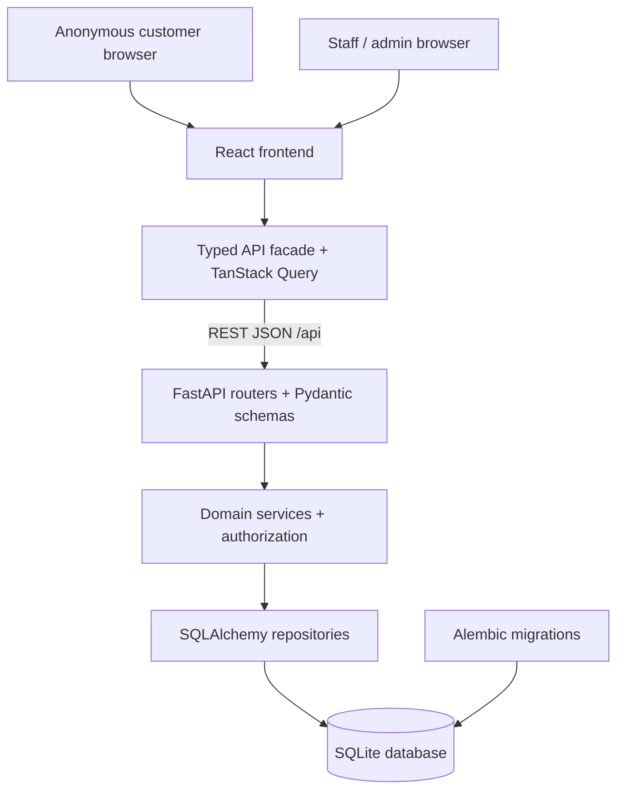

# Kezek — MVP Architecture

**Status:** Selected architecture; implementation is pending.  
**Scope:** Local/demo MVP defined in [plan.md](plan.md).  
**Selected option:** Existing React frontend + FastAPI + SQLAlchemy + SQLite.

This document describes the intended architecture, not completed functionality. The plan remains the source of truth for product scope and acceptance criteria. Preserve working frontend code and record justified deviations in `docs/decisions.md` before implementation.

## 1. Technology stack

| Area | Choice | Purpose |
| --- | --- | --- |
| Frontend | React, strict TypeScript, Vite | Existing application and build tooling |
| Routing | Existing TanStack Router/Start setup | Preserve current routes and application structure |
| UI | Tailwind CSS, shadcn/ui | Shared accessible, responsive components |
| Server state | TanStack Query | Fetching, cache invalidation, polling and request states |
| API client | Central `frontend/src/lib/api` facade | One typed boundary between UI and backend |
| Backend | Python, FastAPI, Pydantic, Uvicorn | REST endpoints, validation and application server |
| Persistence | SQLAlchemy 2.x, SQLite | Relational data and transactional queue operations |
| Migrations | Alembic | Versioned database schema changes |
| API contract | REST, OpenAPI | Documented requests, responses, errors and permissions |
| Authentication | Server-managed sessions, HttpOnly cookies | Staff/admin authentication |
| Tests | Pytest, Vitest, Testing Library, Playwright | Domain, API, UI and browser verification |

The plan names React Router, but the existing frontend uses TanStack Router/Start. Retaining that setup is the selected routing deviation. FastAPI owns all business rules and database access; frontend server features must not create a second backend for queue operations. No Lovable Cloud is required.

## 2. System boundaries



The frontend presents data and collects user intent. FastAPI is authoritative for permissions, queue availability, ticket positions, state transitions and analytics. SQLite is the durable source of truth. Browser caches and mocks never determine the actual queue state.

## 3. Application structure

Paths below are relative to the repository root containing `AGENTS.md`, `frontend/`, `backend/` and `docs/`. Backend paths are proposed, not existing implementation.

```text
frontend/src/
  routes/             Existing TanStack route entries
  components/         Shared UI and feature components
  lib/api/            Public API facade, types, HTTP adapter and isolated mocks
backend/
  app/
    main.py           Application setup and router registration
    core/             Configuration, session security and database setup
    routers/          Public, auth, staff and admin HTTP endpoints
    schemas/          Pydantic request, response and error models
    services/         Authorization, queue rules and transaction orchestration
    repositories/     Persistence queries using a supplied database session
    models/           SQLAlchemy models and database constraints
  migrations/         Alembic configuration and revisions
  tests/              Domain, API, persistence and concurrency tests
docs/
  plan.md
  architecture.md
```

Routers translate HTTP into service calls. Services enforce business rules and own transaction boundaries. Repositories query and modify data within those transactions; they must not independently commit a multi-step operation. Pydantic schemas define the external contract separately from ORM models.

## 4. API and frontend integration

- Use the plan's `/api` prefix without a version segment for the MVP. Document future breaking changes before introducing API versioning.
- All UI calls go through `api` exported from `frontend/src/lib/api`. Components never import the HTTP adapter or mock directly.
- Reconcile `KezekApi`, `types.ts`, `http.ts` and the plan into one agreed contract before backend integration. The existing endpoint map is a starting point, not a complete implementation of the planned API.
- Keep `openapi.yml` aligned with FastAPI's generated schema. Use stable error bodies with `code`, `message` and optional `details`.
- Reconcile existing customer-name inputs, ticket ID routes and bearer-token login with the planned anonymous token access and cookie sessions. Do not collect customer names or phone numbers for this MVP.
- Poll active ticket views and relevant queue summaries approximately every five seconds. Stop ticket polling on terminal states and cancel obsolete requests on navigation.
- Invalidate affected queries after mutations. Show refresh failures and the last successful refresh; never present cached state as a confirmed successful mutation.
- Mocks may support UI development, but the integrated application must explicitly use the real backend through `VITE_API_BASE_URL`.

## 5. Domain model and rules

Use the entities and minimum fields in the plan: organizations, users, services, counters, counter-service associations, staff assignments, daily queues, tickets and ticket events. Add session storage for server-managed authentication.

Each service has one queue per organization-local business date. Store timestamps in UTC and use the organization's IANA timezone for schedules, daily queue selection and reporting. The seed timezone is `Asia/Almaty`.

The only permitted ticket transitions are:

```text
WAITING -> CALLED -> SERVING -> COMPLETED
WAITING -> CANCELLED
CALLED  -> NO_SHOW
```

Services enforce FIFO within a queue and reject invalid transitions with `409`. A counter may have at most one ticket in `CALLED` or `SERVING`. Closing a queue prevents joins but allows existing tickets to be viewed and processed.

Calculate position from authoritative waiting tickets. Estimate wait using waiting tickets ahead, typical service duration and eligible active counters. Return `null` when the estimate lacks sufficient data or counter capacity. Analytics come from persisted timestamps and statuses, never frontend constants.

## 6. Persistence and concurrency

SQLite is selected for a reproducible local/demo setup. Keep its database file on local persistent storage, outside source control. Enable foreign keys on every connection, configure a bounded busy timeout and use WAL mode to improve reader/writer coexistence. WAL still permits only one writer at a time.

Use one database session per request, short transactions and a deliberate writer-locking strategy for queue mutations. For read-then-write operations such as join and call-next, acquire the SQLite write reservation before reading mutable queue state, for example with a correctly configured `BEGIN IMMEDIATE` transaction. An in-process mutex alone is insufficient across processes.

- **Join:** validate queue availability, resolve idempotency, allocate the daily sequence, insert the ticket and append its event in one transaction.
- **Call next:** validate staff assignment and counter availability, select the oldest waiting ticket, assign it and append its event in one transaction.
- **Other transitions:** validate the current state and actor, update timestamps and append the event atomically.

Enforce uniqueness for service/date queues, queue/sequence numbers, queue/ticket numbers and token hashes. Enforce idempotency-key uniqueness within its documented queue scope. Use a database constraint or partial unique index to prevent two active tickets at one counter. Preserve historical records through explicit deletion rules and deactivation.

Define and test retry semantics for join before implementation, including a lost creation response: retries must not issue another ticket, and the token strategy must remain compatible with hash-only token storage. Handle database lock contention with bounded retries or a structured retryable error, never an unbounded wait.

Start with a single backend application worker for the demo; database transactions and constraints must still enforce correctness. A move to PostgreSQL requires migrations, revised locking and concurrency tests rather than only a connection-string change.

## 7. Authentication and authorization

Staff and admins authenticate with Argon2id-hashed passwords and opaque server-managed sessions. Store session-token hashes with user identity and expiry; invalidate sessions on logout. Use HttpOnly, SameSite cookies, Secure cookies under HTTPS, and CSRF protection for cookie-authenticated mutations.

Prefer a same-origin browser setup with `/api` proxied to FastAPI. If separate origins are necessary, use an explicit CORS allowlist and credentialed requests. Update the current HTTP adapter accordingly; secrets must never appear in frontend environment variables.

Anonymous customers use a high-entropy private ticket token. Store only its hash for ticket lookup, and require the token for customer reads and cancellation. Ticket numbers and internal IDs are not customer authorization credentials. Avoid token exposure in logs, analytics and referrer headers; configure application and proxy access logging to redact token-bearing paths.

Every protected service operation verifies role, organization and any required counter assignment. Frontend route guards improve navigation but do not provide backend authorization. Public queue summaries expose aggregates without private ticket data. Rate-limit login and anonymous ticket creation where practical.

## 8. Local operation and configuration

Run the frontend development server and FastAPI as separate processes. Configure API routing, the SQLite path, session secrets and allowed origins through documented environment variables. Keep `.env`, database files and credentials out of Git; provide non-secret `.env.example` files.

Apply Alembic migrations before startup against a fresh database. Provide a repeatable development seed containing an organization, services, counters and clearly labeled demo staff/admin accounts. Restarting the backend must preserve tickets and their history.

Redis, background workers, message brokers, WebSockets and notification providers are outside this MVP architecture. Queue state and polling use the application database and REST API.

## 9. Verification and delivery gates

- **Backend:** Pytest verifies state transitions, organization isolation, assignments, timezone boundaries, private-token access, idempotency, analytics and persistence after restart.
- **Concurrency:** parallel API requests against an isolated file-backed SQLite database verify distinct ticket numbers, single ticket assignment and the one-active-ticket-per-counter rule. Exercise the actual transaction configuration.
- **Frontend:** Vitest and Testing Library verify joining, ticket states, recoverable polling failures, protected navigation and form validation.
- **Browser:** Playwright verifies customer join through staff completion, customer cancellation, admin configuration and unauthorized access against the real backend.
- **Delivery:** lint, type checks, API contract consistency, migrations, seed and documented clean setup must pass before claiming the integrated MVP is complete.

Use isolated test databases, never the development database. Record implementation decisions and actual verification results in the documentation required by the plan.
